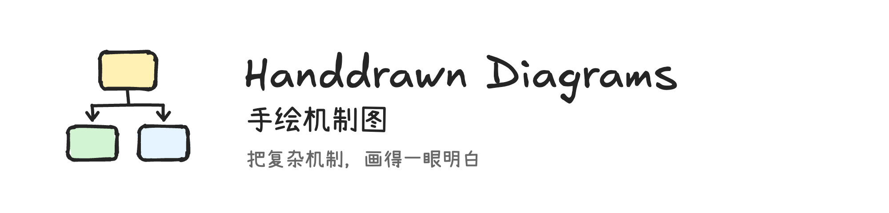
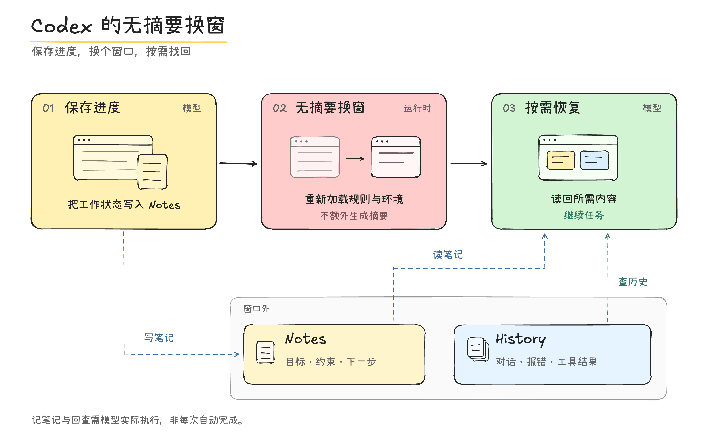
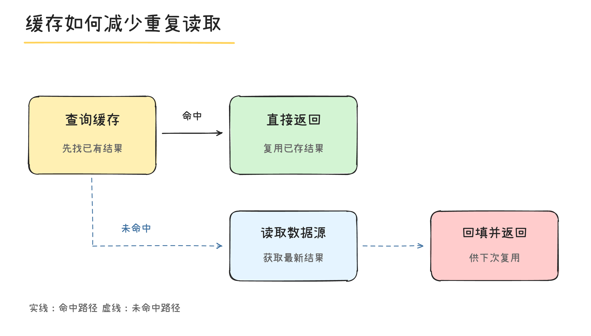
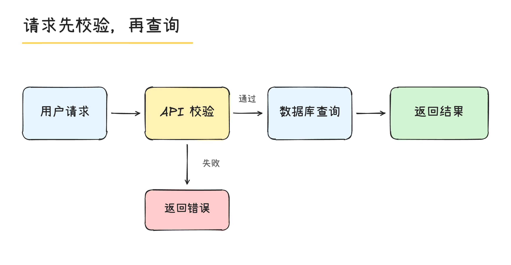

<p align="center">
  
</p>

# Handdrawn Diagrams · 手绘机制图

把技术说明画成 Excalidraw 风格的手绘图，适合中文技术文章、机制讲解和流程说明。

中文手写字体，轻微抖动的线条，柔和色块。图中文字尽量少，主流程和辅助信息分开。默认交付高清 PNG，可以直接插进文章。

这个仓库包含一份 **Codex skill** 和一个 **本地 PNG 渲染器**：Codex 负责理解内容、安排布局，渲染器负责把场景 JSON 画出来。图像渲染不需要图片模型或 API Key。

[图片展示](#图片展示) · [快速开始](#快速开始) · [作为-codex-skill-使用](#作为-codex-skill-使用) · [独立渲染](#独立渲染) · [场景格式](references/renderer.md) · [许可证](#许可证)

## 图片展示

下面都是实际生成的 PNG，图片和对应场景都在仓库中。

### 机制图：主流程与外部材料

三步主流程放在上方，Notes / History 放在下方；虚线表示模型需要主动执行的读写动作。



[查看场景 JSON](examples/context-handoff.scene.json)。这张图用于展示上下文交接的概念与画风，不表示所有 Codex 版本默认启用这一流程。

### 分支图：缓存命中与未命中

实线走命中路径，蓝色虚线走未命中路径。条件写在箭头旁，节点只保留动作和必要说明。



[查看场景 JSON](assets/example.scene.json)

### 流程图：校验失败提前返回

成功路径横向展开，失败分支向下，避免把“校验失败”误画成仍要查询数据库。



[查看场景 JSON](examples/api-flow.scene.json)

## 这套画风怎么用

| 项目 | 默认约定 |
| --- | --- |
| 背景与线条 | 纯白底、近黑轮廓，轻微弯曲或重描 |
| 中文 / 英文 | Xiaolai / Excalifont，字体随仓库提供 |
| 填色 | 淡黄、淡粉、淡绿、淡蓝；颜色按当前图的含义分组 |
| 信息层级 | 标题最醒目，主节点其次，条件与注释更轻 |
| 节点配文 | 一个短标题，必要时再加一两行说明 |
| 箭头 | 分清方向和条件；虚线含义在一张图里保持一致 |
| 导出 | 默认 2 倍像素 PNG，不默认附可编辑源文件 |

适合画技术机制、请求链路、状态变化、架构关系和文章配图。也可以拿已有图片重画，保留原来的事实、方向和关键标签。

布局由模型或场景作者确定，渲染器没有自动排版功能。它不会自动换行、缩字，也不判断技术结论是否正确。

## 快速开始

需要 **Node.js 20 或更新版本**、npm 和 Chromium 浏览器。先克隆仓库：

```bash
git clone https://github.com/UserLcl888/handdrawn-diagrams.git
cd handdrawn-diagrams
```

也可以在 GitHub 下载 ZIP 并解压。然后在包含 `package.json` 的目录运行：

```bash
npm ci
npx playwright install chromium
npm run example
```

生成的文件是 `output/cache-flow.png`。`npm run example` 可以重复运行，会覆盖这个演示输出。

依赖和浏览器安装完成后，渲染可以离线进行。脚本使用仓库内的字体与 Rough.js，不在绘图时下载它们。

如果已有 Chrome / Chromium，可以省略浏览器下载；macOS / Linux 的部分常见安装路径会自动识别，也可以显式指定：

```bash
node scripts/render.cjs assets/example.scene.json \
  --output output/my-first-diagram.png \
  --browser-executable "/path/to/chromium"
```

## 作为 Codex skill 使用

先完成上面的依赖安装，再把仓库链接到 Codex 的用户级技能目录。以下命令适用于 macOS / Linux，在本仓库根目录执行：

```bash
mkdir -p "$HOME/.agents/skills"
skill_target="$HOME/.agents/skills/handdrawn-diagrams"
if [ -e "$skill_target" ] || [ -L "$skill_target" ]; then
  echo "同名技能已存在，请先确认是否需要替换：$skill_target"
else
  ln -s "$PWD" "$skill_target"
fi
```

Windows 上用目录联接代替符号链接，不必移动仓库本身：

```powershell
New-Item -ItemType Junction `
  -Path "$env:USERPROFILE\.codex\skills\handdrawn-diagrams" `
  -Target "<本仓库的绝对路径>"
```

Codex 官方支持扫描符号链接；因此请保留仓库所在位置。具体加载位置见 [Codex skills 文档](https://developers.openai.com/codex/skills/#where-codex-loads-local-skills)。如果没有出现这个技能，重启 Codex 后再试。

也可以把完整仓库复制到你的技能目录，在复制后的目录执行 `npm ci`。运行时需要 `SKILL.md`、`scripts/`、`references/`、`assets/` 等资源，不能只复制一个 Markdown 文件。

在 Codex 中直接这样说：

```text
使用 $handdrawn-diagrams，把下面的缓存读取过程画成一张手绘图：
先查缓存，命中直接返回；未命中就读取数据库，回填缓存后返回。
主流程醒目，条件放在箭头旁，配文少一点，只给我 PNG。
```

重绘已有配图：

```text
使用 $handdrawn-diagrams，把这张图改成手写白板画风。
保留原来的角色、箭头方向和关键标签；中文用手写体，配色柔和。
```

解释复杂机制：

```text
使用 $handdrawn-diagrams，解释新上下文如何恢复工作进度。
图里要有 Notes 和 History，区分主流程与按需回查，
不要把模型主动读写画成每次都会自动发生。
```

Skill 会引导模型先理清关系，再编写场景、渲染并检查实际图片。具体规则见 [SKILL.md](SKILL.md)。

## 独立渲染

渲染器也可以脱离 Codex 使用。写好场景 JSON 后运行：

```bash
node scripts/render.cjs examples/api-flow.scene.json \
  --output output/api-flow.png \
  --scale 2
```

| 参数 | 作用 |
| --- | --- |
| 第一个位置参数 | 场景 JSON 路径 |
| `--output` | 必填，输出 PNG 路径；缺少的父目录会自动创建 |
| `--scale` | 像素倍率，默认 `2`，允许 `1` 到 `4` |
| `--overwrite` | 允许覆盖现有输出；默认拒绝覆盖 |
| `--browser-executable` | 指定 Chromium / Chrome 可执行文件 |
| `--modules-dir` | 使用已有运行环境中的 `node_modules` |

也可以用环境变量 `HANDDRAWN_BROWSER` 指定浏览器；命令行参数优先。

### 一个最小场景

保存为 `scene.json`：

```json
{
  "width": 900,
  "height": 420,
  "seed": 77123,
  "elements": [
    {"type":"text","x":50,"y":55,"text":"读取流程","size":42},
    {"type":"rect","x":50,"y":140,"width":310,"height":160,"fill":"#fff0b3"},
    {"type":"text","x":205,"y":220,"text":"读取数据","size":32,"align":"center"},
    {"type":"arrow","points":[[380,220],[500,220]]},
    {"type":"rect","x":520,"y":140,"width":310,"height":160,"fill":"#d3f4d3"},
    {"type":"text","x":675,"y":220,"text":"返回结果","size":32,"align":"center"}
  ]
}
```

```bash
node scripts/render.cjs scene.json --output output/read-flow.png
```

场景里的坐标都是逻辑像素。上面的 `900 × 420` 画布默认生成 `1800 × 840` PNG。文本的 `y` 是第一行中线；多行内容需要自行插入换行。

支持 `rect`、`ellipse`、`line`、`arrow`、`path` 和 `text`。完整字段与文本定位规则见 [渲染器参考](references/renderer.md)。

## 常见问题

**需要安装 Excalidraw 吗？**

不需要。项目使用 Rough.js 和随仓库提供的字体绘图。它是独立项目，与 Excalidraw 官方无隶属关系。

**能导出 `.excalidraw` 或 SVG 吗？**

通用渲染器目前只导出 PNG。仓库中的 Logo SVG 是专门制作的品牌资产，不代表渲染器支持 SVG 导出。

**为什么中文字体占了十几 MB？**

仓库保留了所用字体的多个 WOFF2 子集，用来覆盖中英文内容，减少依赖本机字体造成的样式变化。遇到字体未覆盖的字符，脚本会报错；它不保证支持所有 Unicode 字符。

**文字太长怎么办？**

先删重复解释、手动换行或调整节点大小。`maxWidth` 用于检查文本是否过宽，不会自动缩小字号。脚本会检查文字出界和缺字；元素遮挡、箭头语义仍需要看图确认。

**提示找不到 Playwright 或 Chromium？**

在仓库目录运行 `npm ci`，然后执行 `npx playwright install chromium`。Linux 环境如果缺少浏览器系统库，可按 [Playwright 官方说明](https://playwright.dev/docs/browsers#install-system-dependencies) 安装。已有浏览器可以通过 `--browser-executable` 指定。

**支持哪些系统？**

本项目已在 macOS、Node.js 24 和 Chrome 上验证。代码支持使用 Playwright 下载的 Chromium，也提供常见 macOS / Linux 浏览器路径回退，Windows 上会依次尝试 Playwright 的 Chromium 与系统 Chrome / Edge；Windows 已实机验证渲染可用，Linux 尚未实机验证。上面的符号链接安装命令适用于 macOS / Linux。

**相同场景每次完全一样吗？**

固定 `seed` 可以稳定手绘线条，但不承诺跨浏览器、跨版本的 PNG 逐字节相同。

## 仓库结构

```text
handdrawn-diagrams/
├── SKILL.md                    # 技能规则与交付约定
├── agents/openai.yaml          # Codex 展示信息
├── scripts/
│   ├── render.cjs              # JSON → PNG
│   ├── build-gallery.cjs       # 重建 README 示例图片
│   └── build-brand.cjs         # 重建 Logo 和横幅
├── references/renderer.md      # 场景格式与命令说明
├── examples/                   # 机制图、API 流程场景
├── docs/images/                # README 展示图
├── assets/
│   ├── brand/                  # Logo、横幅
│   ├── style-reference.png     # 默认画风参考
│   ├── example.scene.json      # 缓存示例
│   ├── fonts/                  # 字体子集
│   ├── fonts.css               # 本地字体声明
│   ├── font-coverage.json      # 字符覆盖表
│   ├── vendor/                # Rough.js
│   └── licenses/              # 第三方原始许可证
├── package.json
├── package-lock.json
├── CONTRIBUTING.md
├── THIRD_PARTY_NOTICES.md
└── LICENSE
```

重建 README 中的示例图片：

```bash
npm run gallery
```

重建 Logo 和横幅：

```bash
npm run brand
```

这两个命令会覆盖仓库中的对应生成资产。日常绘图建议输出到已被 Git 忽略的 `output/`。

## 参与改进

欢迎补充有代表性的机制图、修正排版问题或改进渲染器。提交时附上场景 JSON 和实际 PNG，方便复现。步骤见 [CONTRIBUTING.md](CONTRIBUTING.md)。

## 来源与致谢

本项目的画风约定、本地渲染器与字体打包来自 [lishuangqiang/handdrawn-diagrams](https://github.com/lishuangqiang/handdrawn-diagrams)。导入的上游提交、同步方式以及必须保留的许可文件见 [UPSTREAM.md](UPSTREAM.md)。

## 许可证

原创代码、文档、Logo 与项目示例采用 [MIT License](LICENSE)。字体和第三方库保留各自许可证：Rough.js 为 MIT，Xiaolai / Excalifont 为 SIL OFL 1.1。

具体版本、资源来源及原始许可见 [THIRD_PARTY_NOTICES.md](THIRD_PARTY_NOTICES.md)。
